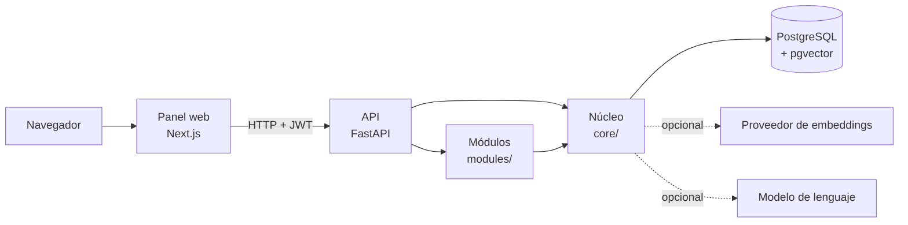

# Neural Memory Core

Sistema de memoria artificial persistente, modular y ampliable: un "segundo cerebro" que
guarda lo que le cuentas, lo relaciona, conserva su historial y responde preguntas citando
siempre de dónde sale cada dato.

- **Persistencia real.** Los recuerdos viven en PostgreSQL, en un volumen independiente del
  código. Reiniciar, actualizar o reinstalar la aplicación no los borra.
- **Nunca inventa.** Las respuestas separan lo *confirmado* por tus recuerdos, las
  *inferencias* del sistema y lo *no encontrado*, y cada afirmación enlaza a su fuente.
- **Nunca sobrescribe.** Cada cambio crea una versión nueva; se puede consultar y revertir.
- **Funciona sin claves ni servicios de pago.** Los embeddings y las respuestas tienen un modo
  local y gratuito. Los proveedores externos son opcionales.
- **Modular.** Cada módulo (proyectos, tareas, documentos…) se añade o se quita sin tocar el
  núcleo.

Versión actual: ver [`VERSION`](VERSION). Estado del proyecto: [`PROJECT_STATUS.md`](PROJECT_STATUS.md).

## Puesta en marcha rápida (Docker)

Requisitos: Docker con Docker Compose.

```bash
git clone https://github.com/Miguel-Colmenares/neural-memory-core.git
cd neural-memory-core
cp .env.example .env
```

Edita `.env` y rellena **tres** valores:

| Variable | Qué poner |
| --- | --- |
| `POSTGRES_PASSWORD` | Una contraseña larga para la base de datos |
| `NMC_SECRET_KEY` | El resultado de `python3 -c "import secrets; print(secrets.token_urlsafe(48))"` |
| `NMC_ADMIN_PASSWORD` | La contraseña de tu usuario `admin` (mínimo 10 caracteres) |

```bash
docker compose up -d --build
```

- Panel web: <http://localhost:3000>
- API y documentación interactiva: <http://localhost:8000/docs>

Entra con el usuario `admin` y la contraseña que pusiste. La guía completa, incluida la
instalación sin Docker, está en [`docs/user_guide/instalacion.md`](docs/user_guide/instalacion.md).

> La imagen de la API incluye por defecto el modelo local de embeddings (FastEmbed), lo que
> la hace más pesada. Para una imagen ligera pon `NMC_IMAGE_EXTRAS=` (vacío) en `.env`.

## Qué puedes hacer

| Función | Dónde |
| --- | --- |
| Guardar recuerdos (episódicos, semánticos, de proyecto, preferencias, documentos) | Panel → Recuerdos, `POST /api/v1/memories` |
| Preguntar en lenguaje natural con fuentes | Panel → Buscador, `POST /api/v1/ask` |
| Buscar por texto y por parecido | Panel → Buscador, `POST /api/v1/search` |
| Proyectos con objetivos, decisiones, tareas y documentación | Panel → Proyectos |
| Subir archivos de texto y PDF | Panel → Documentos |
| Ver relaciones entre recuerdos | Panel → Relaciones |
| Corregir un recuerdo conservando el anterior, y revertir | Detalle del recuerdo |
| Historial de todo lo que ha cambiado | Panel → Historial |
| Exportar e importar toda la memoria (JSON) | Panel → Exportar e importar |
| Respaldos y restauración de la base | Panel → Almacenamiento, `scripts/manage.py` |

## Proveedores de IA: qué es gratis y qué no

| Componente | Opción | Costo | Notas |
| --- | --- | --- | --- |
| Embeddings | `hashing` (por defecto) | Gratis, local | Parecido por palabras. No entiende sinónimos. |
| Embeddings | `fastembed` | Gratis, local | Modelo multilingüe; descarga unos 220 MB la primera vez. Búsqueda por significado. |
| Embeddings | `openai` | **Puede costar** | Cualquier API compatible con OpenAI. Envía el texto al proveedor. |
| Respuestas | `none` (por defecto) | Gratis | Respuestas extractivas: citas literales de tus recuerdos. |
| Respuestas | `openai` | **Puede costar** | API compatible con OpenAI. Con Ollama o LM Studio en tu equipo es gratis. |

El sistema completo funciona con las dos opciones por defecto, sin ninguna clave. Detalles en
[`docs/architecture/embeddings.md`](docs/architecture/embeddings.md).

## Arquitectura en una imagen



Los datos, la lógica, la IA y la interfaz están separados: el panel solo habla con la API, la
API solo orquesta, y toda la lógica vive en `core/` y `modules/`.

## Estructura del repositorio

```
apps/api            API HTTP (FastAPI)
apps/web            Panel de control (Next.js + TypeScript + Tailwind)
core/               Núcleo: memoria, versionado, ingesta, recuperación, embeddings,
                    grafo, seguridad, respaldos y sistema de módulos
modules/            Módulos: personal, projects, conversations, documents, knowledge, tasks
infrastructure/     Docker, migraciones de base de datos y notas de despliegue
tests/              Pruebas unitarias, de integración y de extremo a extremo
docs/               Arquitectura, API, guías de uso, módulos y decisiones técnicas
scripts/manage.py   Herramienta de línea de comandos (usuarios, respaldos, exportación…)
```

## Documentación

| Tema | Documento |
| --- | --- |
| Instalación | [`docs/user_guide/instalacion.md`](docs/user_guide/instalacion.md) |
| Uso del panel | [`docs/user_guide/uso.md`](docs/user_guide/uso.md) |
| Despliegue en un servidor | [`docs/user_guide/despliegue.md`](docs/user_guide/despliegue.md) |
| Respaldos y recuperación ante pérdida del servidor | [`docs/user_guide/respaldos_y_recuperacion.md`](docs/user_guide/respaldos_y_recuperacion.md) |
| Arquitectura y diagrama de componentes | [`docs/architecture/README.md`](docs/architecture/README.md) |
| Modelo de base de datos y diccionario de datos | [`docs/architecture/modelo_de_datos.md`](docs/architecture/modelo_de_datos.md) |
| Cómo se recupera y se responde | [`docs/architecture/recuperacion.md`](docs/architecture/recuperacion.md) |
| Embeddings | [`docs/architecture/embeddings.md`](docs/architecture/embeddings.md) |
| API | [`docs/api/README.md`](docs/api/README.md) |
| Módulos y cómo crear uno | [`docs/modules/README.md`](docs/modules/README.md), [`docs/modules/crear_modulo.md`](docs/modules/crear_modulo.md) |
| Decisiones técnicas | [`docs/decisions/`](docs/decisions/) |
| Cómo contribuir | [`CONTRIBUTING.md`](CONTRIBUTING.md) |
| Cambios por versión | [`CHANGELOG.md`](CHANGELOG.md) |

## Desarrollo

```bash
python -m venv .venv && source .venv/bin/activate
make install          # dependencias de Python y del panel
make test             # pruebas (necesita PostgreSQL con pgvector)
make lint             # ruff + eslint + tipos
```

Las pruebas necesitan una base PostgreSQL con pgvector. La forma más simple:

```bash
docker run -d --name nmc-test-db -p 5432:5432 \
  -e POSTGRES_USER=nmc -e POSTGRES_PASSWORD=nmc -e POSTGRES_DB=nmc_test \
  pgvector/pgvector:pg17
```

## Seguridad y privacidad

- Este repositorio contiene **solo código**. Tus recuerdos están en la base de datos y en
  `backups/`, ambos fuera de Git (ver `.gitignore`).
- Los secretos se leen de variables de entorno (`.env`, que tampoco se sube).
- Todos los endpoints salvo `/health` y el inicio de sesión exigen autenticación.
- No abras incidencias con recuerdos, contraseñas o tokens.

## Licencia

MIT. Ver [`LICENSE`](LICENSE).
