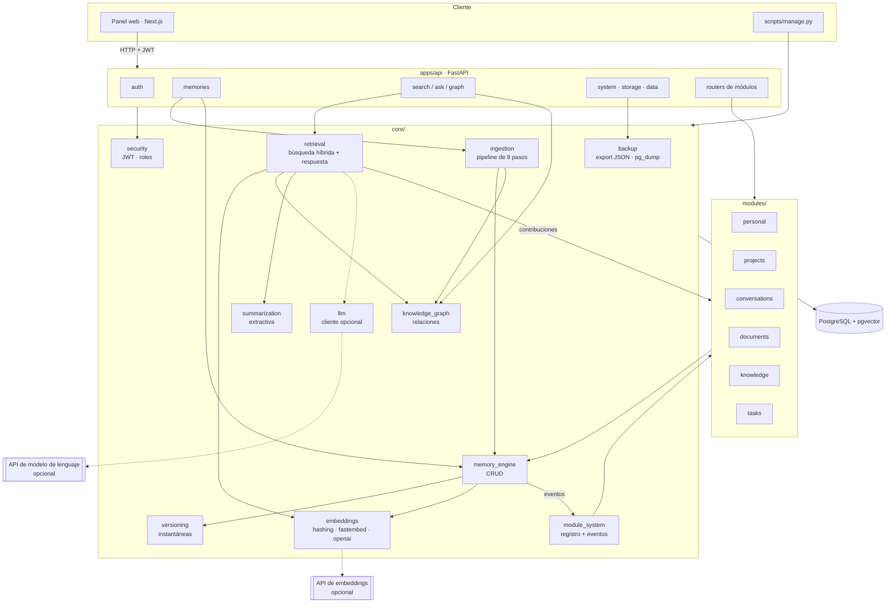

# Arquitectura

Neural Memory Core es un monolito modular: un único servicio de API con el núcleo y los
módulos en el mismo proceso, una base de datos y un panel web. No hay microservicios ni colas
porque el sistema lo opera una sola persona y esa complejidad no aportaría nada
(ver [ADR 0001](../decisions/0001-monolito-modular.md)).

## Principio de separación

| Capa | Dónde | Responsabilidad | No hace |
| --- | --- | --- | --- |
| Interfaz | `apps/web` | Mostrar y pedir datos a la API | No contiene lógica ni datos |
| API | `apps/api` | Validar entradas, autenticar, traducir HTTP ↔ núcleo | No contiene reglas de negocio |
| Lógica | `core/`, `modules/` | Memoria, versionado, ingesta, recuperación | No sabe de HTTP |
| IA | `core/embeddings`, `core/llm` | Proveedores intercambiables tras una interfaz | No decide qué es verdad |
| Datos | PostgreSQL + pgvector | Única fuente de verdad | — |

## Diagrama de componentes

Las líneas discontinuas son dependencias opcionales: sin ellas el sistema sigue funcionando.

## Componentes del núcleo

| Paquete | Qué hace |
| --- | --- |
| `core/config.py` | Lee toda la configuración de variables `NMC_*`. Se niega a arrancar sin `NMC_SECRET_KEY`. |
| `core/database` | Modelos SQLAlchemy y registro de cambios (`change_log`). |
| `core/memory_engine` | Crear, actualizar, archivar, reactivar, revertir, eliminar y listar recuerdos. |
| `core/versioning` | Guarda una instantánea inmutable por cada versión de cada recuerdo. |
| `core/ingestion` | Recibe información nueva y la incorpora en 9 pasos (ver abajo). |
| `core/embeddings` | Proveedores de vectores, troceado de textos largos e indexación. |
| `core/retrieval` | Búsqueda por texto, por vectores, fusión, reordenado y construcción de respuestas. |
| `core/knowledge_graph` | Relaciones entre recuerdos y grafo para el panel. |
| `core/summarization` | Selección extractiva de frases. No genera texto nuevo. |
| `core/llm` | Cliente opcional para APIs compatibles con OpenAI. |
| `core/security` | Contraseñas (bcrypt), tokens (JWT), roles y límite de intentos de acceso. |
| `core/backup` | Exportación e importación JSON; respaldos con `pg_dump` / `pg_restore`. |
| `core/module_system` | Contrato de módulos, registro y bus de eventos. |

## Flujo de incorporación de información

Al recibir información nueva (`POST /memories`, una conversación, un documento…), el
*pipeline* de `core/ingestion/pipeline.py` hace:

1. **Analizar** el contenido (normalizar, validar tamaño).
2. **Clasificar** el tipo de memoria por reglas, si no se indicó. La regla aplicada queda
   anotada en `metadata.classification`.
3. **Detectar duplicados** exactos por huella del contenido. Si existe, no se crea otro.
4. **Buscar relación** con recuerdos existentes por parecido.
5. **Guardar** el recuerdo con su procedencia.
6. **Crear embeddings** (uno por fragmento si el texto es largo).
7. **Etiquetar** automáticamente (las etiquetas automáticas se distinguen de las tuyas).
8. **Asociar** al proyecto correspondiente si se indicó.
9. **Registrar** el cambio en el historial.

Si la información nueva contradice a otra, **se conservan las dos**: se enlazan con una
relación `contradicts` o `supersedes` y la respuesta muestra ambas con su fecha.

## Flujo de una pregunta

Ver [`recuperacion.md`](recuperacion.md).

## Garantías que el código hace cumplir

| Principio | Cómo se cumple |
| --- | --- |
| No sobrescribir sin historial | Toda modificación pasa por `MemoryService`, que crea una fila en `memory_versions`. |
| Trazabilidad del origen | `source_type`, `source_ref`, `provenance`, `created_by` en cada recuerdo. |
| No inventar | La respuesta por defecto solo cita frases literales. Con modelo de lenguaje, se descartan las afirmaciones que no citan una fuente recuperada. |
| Exportable y restaurable | Exportación JSON completa y respaldos `pg_dump`, ambos probados en la suite. |
| Sin secretos en Git | Configuración solo por entorno; `.gitignore` excluye `.env`, respaldos y exportaciones. |
| Módulos independientes | Los módulos solo usan la API pública del núcleo y se activan por configuración. |

## Otros documentos

- [Modelo de datos y diccionario](modelo_de_datos.md)
- [Recuperación y respuestas](recuperacion.md)
- [Embeddings](embeddings.md)
- [Decisiones técnicas](../decisions/)
