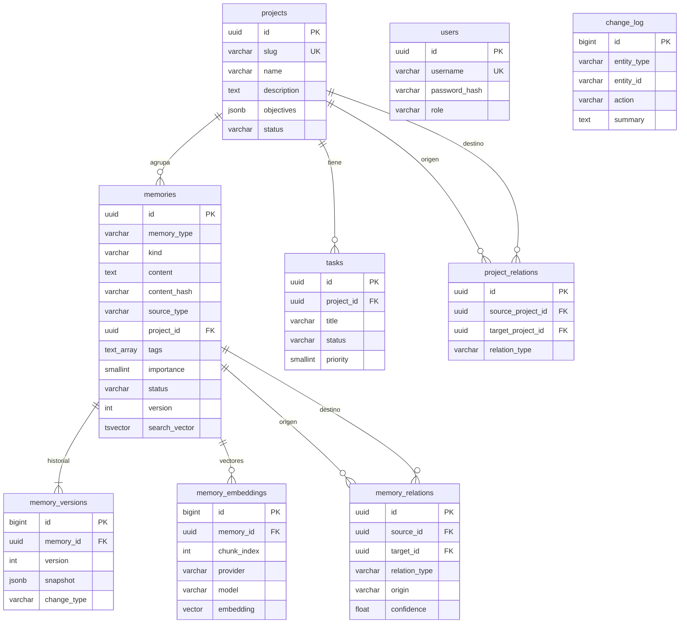

# Modelo de base de datos y diccionario de datos

Motor: PostgreSQL 17 con la extensión `vector` (pgvector). El esquema se crea y evoluciona
solo con migraciones de Alembic (`infrastructure/database/migrations`).

## Diagrama entidad-relación



`users` y `change_log` no tienen claves foráneas a propósito: el historial debe sobrevivir a
la eliminación de aquello que describe, y el autor se guarda como nombre de usuario.

## Tipos de memoria

Todos los tipos comparten la tabla `memories`; se distinguen por `memory_type` y `kind`.

| `memory_type` | Qué guarda | Campos que usa |
| --- | --- | --- |
| `episodic` | Conversaciones, eventos, decisiones, cambios con fecha | `occurred_at` (fecha del hecho), `created_at`, `source_type`/`source_ref` (fuente), `content` (contenido), `title` (resumen breve), `project_id` |
| `semantic` | Conceptos, hechos, conocimientos y sus relaciones | `kind` (`concept`, `fact`…), `content`, `memory_relations` |
| `project` | Objetivos, decisiones, problemas, tareas, documentación | `project_id`, `kind` (`decision`, `problem`…); los objetivos están en `projects.objectives` y las tareas en `tasks` |
| `preference` | Formatos, herramientas, estilo, configuraciones | `kind = preference`, `metadata.preference_key` |
| `document` | Archivos procesados | `source_ref` (nombre del archivo), `provenance` (tipo, tamaño, páginas, huella), `memory_embeddings` (fragmentos), `created_at` (fecha de ingreso), `version` (versión del documento) |

## Diccionario de datos

### `memories`: los recuerdos

| Columna | Tipo | Nulo | Descripción |
| --- | --- | --- | --- |
| `id` | uuid | no | Identificador. |
| `memory_type` | varchar(20) | no | `episodic`, `semantic`, `project`, `preference` o `document`. |
| `kind` | varchar(50) | no | Clase más concreta: `note`, `decision`, `concept`, `conversation`, `preference`… Los módulos pueden añadir las suyas. |
| `title` | varchar(300) | sí | Título o resumen breve. |
| `content` | text | no | Contenido completo. |
| `content_hash` | varchar(64) | no | SHA-256 del contenido normalizado; detecta duplicados exactos. |
| `source_type` | varchar(30) | no | Procedencia: `manual`, `conversation`, `document`, `import`, `api`, `module`. |
| `source_ref` | varchar(500) | sí | Referencia a la fuente: archivo, URL, reunión… |
| `provenance` | jsonb | no | Detalle de la procedencia (por ejemplo, datos del archivo original). |
| `project_id` | uuid | sí | Proyecto asociado. Si el proyecto se elimina, queda en nulo. |
| `module` | varchar(50) | sí | Módulo que creó el recuerdo. |
| `tags` | varchar(80)[] | no | Etiquetas. |
| `importance` | smallint | no | De 1 a 5 (3 por defecto). Influye en el orden de los resultados. |
| `metadata` | jsonb | no | Datos adicionales, incluida la clasificación automática y sus reglas. |
| `status` | varchar(10) | no | `active` o `archived`. |
| `occurred_at` | timestamptz | sí | Cuándo ocurrió lo que se recuerda. |
| `version` | integer | no | Número de la versión vigente. |
| `created_by` | varchar(80) | sí | Usuario que lo creó. |
| `created_at` | timestamptz | no | Fecha de creación. |
| `updated_at` | timestamptz | no | Fecha del último cambio. |
| `search_vector` | tsvector | — | Columna generada para la búsqueda de texto (título con peso A, contenido con peso B). |

Índices: GIN sobre `search_vector` y sobre `tags`; B-tree sobre `(memory_type, status)`,
`created_at`, `kind`, `content_hash` y `project_id`.

### `memory_versions`: historial de cada recuerdo

| Columna | Tipo | Nulo | Descripción |
| --- | --- | --- | --- |
| `id` | bigint | no | Identificador. |
| `memory_id` | uuid | no | Recuerdo. Se borra en cascada con él. |
| `version` | integer | no | Número de versión. Único por recuerdo. |
| `snapshot` | jsonb | no | Copia completa del recuerdo en esa versión. |
| `change_type` | varchar(30) | no | `create`, `update`, `correction`, `archive`, `restore`, `revert`. |
| `change_reason` | text | sí | Motivo indicado por quien hizo el cambio. |
| `changed_fields` | jsonb | no | Lista de campos que cambiaron. |
| `changed_by` | varchar(80) | sí | Usuario. |
| `created_at` | timestamptz | no | Fecha del cambio. |

La versión 1 se guarda al crear el recuerdo. Revertir no borra versiones: crea una nueva con
el contenido de la antigua.

### `memory_embeddings`: vectores de búsqueda

| Columna | Tipo | Nulo | Descripción |
| --- | --- | --- | --- |
| `id` | bigint | no | Identificador. |
| `memory_id` | uuid | no | Recuerdo. Cascada. |
| `chunk_index` | integer | no | Posición del fragmento. Único por recuerdo. |
| `chunk_text` | text | no | Texto del fragmento. |
| `provider` | varchar(40) | no | Proveedor que generó el vector. |
| `model` | varchar(200) | no | Modelo usado. |
| `embedding` | vector(384) | no | Vector. Índice HNSW con distancia coseno. |
| `created_at` | timestamptz | no | Fecha de generación. |

Esta tabla es regenerable (`reindex`), por eso no entra en la exportación JSON.

### `memory_relations`: grafo de conocimiento

| Columna | Tipo | Nulo | Descripción |
| --- | --- | --- | --- |
| `id` | uuid | no | Identificador. |
| `source_id`, `target_id` | uuid | no | Recuerdos relacionados. Deben ser distintos. Cascada. |
| `relation_type` | varchar(40) | no | `related`, `possible_duplicate`, `contradicts`, `supersedes`, u otro que definas. |
| `origin` | varchar(10) | no | `auto` (detectada por el sistema) o `manual` (creada por ti). |
| `confidence` | float | sí | Parecido medido, en relaciones automáticas. |
| `note` | text | sí | Nota libre. |
| `created_by` | varchar(80) | sí | Usuario. |
| `created_at` | timestamptz | no | Fecha. |

Único por `(source_id, target_id, relation_type)`.

### `projects`

| Columna | Tipo | Nulo | Descripción |
| --- | --- | --- | --- |
| `id` | uuid | no | Identificador. |
| `slug` | varchar(120) | no | Nombre corto único, derivado del nombre. |
| `name` | varchar(200) | no | Nombre. |
| `description` | text | no | Descripción. |
| `objectives` | jsonb | no | Lista de objetivos. |
| `status` | varchar(20) | no | `active`, `paused`, `completed`, `archived`. |
| `metadata` | jsonb | no | Datos adicionales. |
| `created_at`, `updated_at` | timestamptz | no | Fechas. |

### `project_relations`

| Columna | Tipo | Nulo | Descripción |
| --- | --- | --- | --- |
| `id` | uuid | no | Identificador. |
| `source_project_id`, `target_project_id` | uuid | no | Proyectos relacionados. Distintos. Cascada. |
| `relation_type` | varchar(50) | no | Por ejemplo `related`, `depends_on`, `continues`. |
| `description` | text | no | Explicación. |
| `created_at` | timestamptz | no | Fecha. |

### `tasks` (tabla del módulo de tareas)

| Columna | Tipo | Nulo | Descripción |
| --- | --- | --- | --- |
| `id` | uuid | no | Identificador. |
| `project_id` | uuid | sí | Proyecto. Nulo si se elimina el proyecto. |
| `title` | varchar(300) | no | Título. |
| `description` | text | no | Detalle. |
| `status` | varchar(20) | no | `pending`, `in_progress`, `done`, `cancelled`. |
| `priority` | smallint | no | De 1 a 5. |
| `due_date` | date | sí | Fecha límite. |
| `created_at`, `updated_at` | timestamptz | no | Fechas. |
| `completed_at` | timestamptz | sí | Cuándo se completó. |

### `users`

| Columna | Tipo | Nulo | Descripción |
| --- | --- | --- | --- |
| `id` | uuid | no | Identificador. |
| `username` | varchar(80) | no | Nombre de usuario, único. |
| `password_hash` | varchar(200) | no | Hash bcrypt. La contraseña nunca se guarda. |
| `role` | varchar(20) | no | `admin`, `editor` o `reader`. |
| `is_active` | boolean | no | Si puede iniciar sesión. |
| `created_at` | timestamptz | no | Fecha de alta. |

Los usuarios no se incluyen en la exportación JSON. Sí están en los respaldos `pg_dump`.

### `change_log`: historial de actualizaciones

| Columna | Tipo | Nulo | Descripción |
| --- | --- | --- | --- |
| `id` | bigint | no | Identificador. |
| `entity_type` | varchar(40) | no | `memory`, `project`, `relation`, `task`, `system`… |
| `entity_id` | varchar(64) | no | Identificador de la entidad afectada. |
| `project_id` | uuid | sí | Proyecto relacionado, para filtrar. |
| `action` | varchar(40) | no | `create`, `update`, `archive`, `delete`, `import`, `backup`… |
| `summary` | text | no | Descripción legible. |
| `details` | jsonb | no | Datos del cambio. |
| `actor` | varchar(80) | sí | Usuario. |
| `created_at` | timestamptz | no | Fecha. |

Al eliminar definitivamente un recuerdo, sus entradas permanecen (queda constancia de que
existió y se eliminó), pero los resúmenes se sustituyen por «[recuerdo eliminado]» para que
no quede copia del contenido.

## Migraciones

```bash
alembic upgrade head                              # aplicar
alembic revision --autogenerate -m "descripción"  # crear tras cambiar los modelos
alembic check                                     # comprobar que modelos y migraciones coinciden
```

El contenedor de la API aplica las migraciones pendientes al arrancar.
