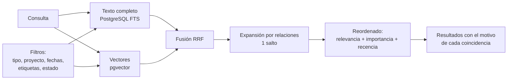

# Recuperación y respuestas

Cómo el sistema encuentra recuerdos y cómo construye una respuesta sin inventar nada.

## Búsqueda híbrida (`POST /api/v1/search`)



1. **Texto completo.** Columna `search_vector` (configuración `spanish`; el título pesa más
   que el contenido). La consulta se trata como "cualquiera de estas palabras" para no perder
   resultados parciales.
2. **Vectores.** Distancia coseno contra `memory_embeddings`, solo con vectores del proveedor
   activo, descartando los que no superan su umbral mínimo.
3. **Filtros.** Tipo de memoria, clase, proyecto, etiquetas, rango de fechas y estado se
   aplican dentro de ambas búsquedas, no después.
4. **Fusión.** *Reciprocal Rank Fusion* (k = 60): un recuerdo que aparece alto en las dos
   listas queda por encima de uno que solo aparece en una.
5. **Relaciones.** Se añaden los vecinos directos (un salto) de los mejores resultados, con
   la puntuación reducida a la mitad y ponderada por la confianza de la relación.
6. **Reordenado.** `puntuación = relevancia × 0,80 + importancia × 0,12 + recencia × 0,08`.
   Si la pregunta pide "lo último" o "lo reciente", la recencia pesa 0,40. La recencia decae
   con una vida media de 120 días.

Cada resultado indica por qué apareció (`text`, `semantic`, `relation`), sus puntuaciones
parciales y el fragmento que coincidió. El parámetro `mode` permite forzar `text` o
`semantic`.

## Entender la pregunta (`POST /api/v1/ask`)

`core/retrieval/query_analysis.py` analiza la pregunta **con reglas, sin modelo de lenguaje**,
para que el comportamiento sea predecible y gratuito. Detecta:

| Intención | Ejemplo | Efecto |
| --- | --- | --- |
| `latest_project` | "mi último proyecto" | Resuelve el proyecto con actividad más reciente |
| `project_relation` | "qué relación existe entre este proyecto y el anterior" | Compara dos proyectos |
| `decisions` | "qué decisiones había tomado" | Filtra recuerdos de clase `decision` |
| `changes` | "qué cambios hice desde la última versión" | Consulta el historial de cambios |
| `recent` | "información reciente" | Sube el peso de la recencia |
| `tasks` | "qué tengo pendiente" | Pide datos al módulo de tareas |
| `preferences` | "qué prefiero" | Filtra memoria de preferencias |
| `documents`, `conversations` | "en qué documento…" | Filtra por tipo de memoria |

También reconoce nombres de proyectos mencionados en la pregunta. El análisis completo se
devuelve en la respuesta (`interpretation`) para que puedas ver cómo se interpretó.

## Construcción de la respuesta

La respuesta tiene siempre tres secciones separadas:

| Sección | Contenido | Garantía |
| --- | --- | --- |
| `confirmed` | Hechos respaldados por una fuente | Cada elemento cita al menos una fuente |
| `inferences` | Deducciones del sistema | Dice en qué se basa; nunca se presenta como hecho |
| `not_found` | Lo que se preguntó y no está en la memoria | Se dice explícitamente |

y una lista `sources` con el recuerdo, proyecto, tarea o cambio del que sale cada dato.

### Modo extractivo (por defecto, sin costo)

Las frases de `confirmed` son **citas literales** de tus recuerdos, elegidas por coincidencia
con la pregunta. El sistema no redacta nada nuevo, así que no puede inventar. Un ejemplo de
inferencia en este modo: «Interpreté "último proyecto" como "Huerto urbano" porque es el que
tiene la actividad más reciente».

Si hay recuerdos enlazados como contradictorios, se muestran los dos con su fecha en lugar de
elegir uno.

### Modo con modelo de lenguaje (opcional)

Con `NMC_LLM_PROVIDER=openai`, el modelo recibe **solo** las fuentes recuperadas y debe
devolver un JSON con las mismas tres secciones. Después el sistema:

- descarta cualquier afirmación que no cite una fuente existente;
- si el modelo falla, tarda demasiado o devuelve algo inválido, responde en modo extractivo
  y lo indica en `answer_mode` y `warnings`.

El modelo redacta mejor, pero puede parafrasear de forma imprecisa: las fuentes siguen
mostrándose para que lo compruebes.

**Aviso:** un proveedor en la nube puede tener costo y recibe el texto de las fuentes. Con
Ollama o LM Studio en tu propio equipo no hay costo ni salida de datos:

```ini
NMC_LLM_PROVIDER=openai
NMC_LLM_API_BASE=http://host.docker.internal:11434/v1
NMC_LLM_MODEL=llama3.1
NMC_LLM_API_KEY=ollama
```

> **Estado de verificación:** el camino con modelo de lenguaje está cubierto por pruebas con
> un servidor simulado (respuestas válidas, sin citas e inválidas). No se probó contra un
> proveedor real.

## Límites conocidos

- Con el proveedor `hashing` no hay búsqueda por sinónimos. Usa `fastembed` para eso.
- El análisis por reglas está pensado para español. Preguntas muy indirectas pueden no
  activar ninguna intención; en ese caso se hace una búsqueda híbrida normal.
- La expansión por relaciones es de un solo salto.
